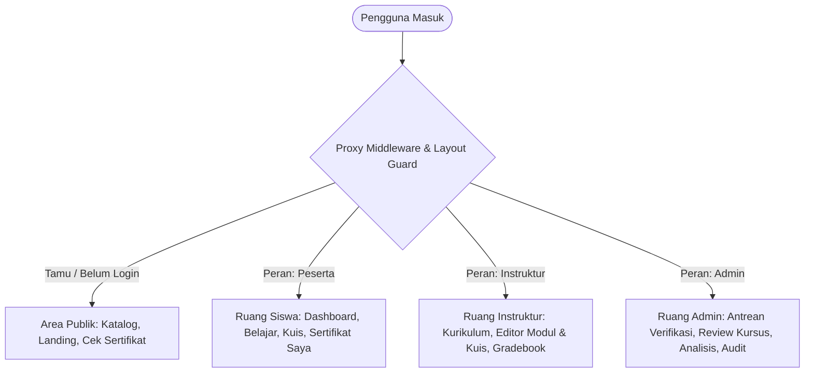

# LAPORAN KOMPREHENSIF ARSITEKTUR, FITUR, HALAMAN & ATURAN SISTEM
## LMS Lembaga Kursus & Pelatihan Pijar Aksara (Terekonsiliasi Sesuai PRD)

**Institusi:** Lembaga Kursus & Pelatihan Pijar Aksara (Depok, Jawa Barat)  
**Teknologi:** Next.js (App Router, Server Actions, Turbopack), TypeScript, Tailwind CSS, Supabase (PostgreSQL, RLS, RPCs, Storage, Auth), Mayar Payment Gateway, Resend Email Service.  
**Dokumen Acuan:** PRD+ERDlms.md, docs/HASIL_UJI.md, docs/HASIL_REGRESI.md  
**Status Laporan:** Terekonsiliasi Penuh (26 Oktober 2026)

---

## DAFTAR ISI
1. [Ringkasan Eksekutif & Struktur Peran](#1-ringkasan-eksekutif--struktur-peran)
2. [Peta Seluruh Halaman Aplikasi (Sitemap & Routing)](#2-peta-seluruh-halaman-aplikasi-sitemap--routing)
3. [Rincian Fitur Berdasarkan Peran Pengguna](#3-rincian-fitur-berdasarkan-peran-pengguna)
   - [A. Peran Peserta (Siswa)](#a-peran-peserta-siswa)
   - [B. Peran Instruktur](#b-peran-instruktur)
   - [C. Peran Administrator (Admin)](#c-peran-administrator-admin)
   - [D. Halaman Publik & Tamu](#d-halaman-publik--tamu)
4. [Kompilasi Aturan Main Bisnis (Business Rules Engine)](#4-kompilasi-aturan-main-bisnis-business-rules-engine)
   - [Aturan 1: Standar Nilai Lulus (KKM), Skala Penilaian & Batas Percobaan Kuis](#aturan-1-standar-nilai-lulus-kkm-skala-penilaian--batas-percobaan-kuis)
   - [Aturan 2: Pembelajaran Sekuensial & Anti-Skip Policy](#aturan-2-pembelajaran-sekuensial--anti-skip-policy)
   - [Aturan 3: Kerahasiaan Kunci Jawaban & Integritas Evaluasi](#aturan-3-kerahasiaan-kunci-jawaban--integritas-evaluasi)
   - [Aturan 4: Sertifikasi Resmi & Verifikasi Digital QR Code](#aturan-4-sertifikasi-resmi--verifikasi-digital-qr-code)
   - [Aturan 5: Batas Waktu Pembayaran 24 Jam, Status Kedaluwarsa & Pembatalan](#aturan-5-batas-waktu-pembayaran-24-jam-status-kedaluwarsa--pembatalan)
   - [Aturan 6: Proteksi Konten & State Machine Siklus Hidup Kursus](#aturan-6-proteksi-konten--state-machine-siklus-hidup-kursus)
5. [Arsitektur Database, Keamanan & Migrasi SQL](#5-arsitektur-database-keamanan--migrasi-sql)
6. [Integrasi Layanan Eksternal & Background Workers](#6-integrasi-layanan-eksternal--background-workers)

---

## 1. RINGKASAN EKSEKUTIF & STRUKTUR PERAN

LMS Lembaga Kursus Pijar Aksara dirancang sebagai platform pembelajaran vokasi dan pelatihan keterampilan praktis terpadu yang memadukan otomasi evaluasi belajar, alur kurikulum berstandar industri, sistem verifikasi pembayaran berkecepatan tinggi, dan sertifikasi digital anti-pemalsuan.

Sistem memiliki pembagian 4 hak akses peran yang terisolasi secara ketat (*Row-Level Security* dan *Server Proxy Guards*):

---

## 2. PETA SELURUH HALAMAN APLIKASI (SITEMAP & ROUTING)

Berikut adalah daftar lengkap seluruh rute halaman web yang telah dibangun dan aktif:

| Rute URL | Nama Halaman | Akses Peran | Deskripsi Fungsional |
| :--- | :--- | :--- | :--- |
| `/` | Landing Page Institusi | Publik | Beranda resmi institusi, hero banner, program unggulan, kredensial resmi, testimoni, dan footer |
| `/kursus` | Katalog Kursus Vokasi | Publik / Siswa | Pencarian, filter kategori/level/harga, pagination, dan unduh brosur PDF resmi (hanya kursus `terbit`) |
| `/kursus/[slug]` | Detail & Silabus Kursus | Publik / Siswa | Informasi instruktur, silabus modul, indikator gembok sekuensial, unduh brosur, dan tombol daftar |
| `/login` | Masuk ke Akun | Tamu (Anti-Flash) | Autentikasi email & kata sandi dengan pengalihan instan ke ruang kerja masing-masing peran |
| `/register` / `/daftar` | Registrasi Akun Siswa | Tamu (Anti-Flash) | Pendaftaran akun peserta baru dengan validasi format nama, email, nomor HP/WhatsApp, dan kata sandi |
| `/dashboard` | Dashboard Siswa | Siswa (Peserta) | **Pusat kendali siswa:** Bilah sticky tab panduan, meter capaian belajar, 4 kartu skala tugas, aturan main 1-5, dan FAQ |
| `/kursus-saya` | Kursus Saya | Siswa (Peserta) | Daftar seluruh pendaftaran kursus (filter Aktif, Menunggu Bayar, Selesai), tombol lanjut belajar, dan bayar |
| `/kursus-saya/[id]/bayar` | Ruang Pembayaran | Siswa (Peserta) | Pilihan pembayaran ganda: QRIS Otomatis (Mayar) atau Transfer Bank Manual (BCA, Mandiri, BRI) + upload ke bucket `bukti_bayar` |
| `/belajar/[slug]` | Ruang Belajar Modul | Siswa Terdaftar | Pemutar video pembelajaran, artikel materi instruktur, navigasi sekuensial, dan tombol tandai baca |
| `/belajar/[slug]/kuis` | Ruang Kuis Evaluasi | Siswa Terdaftar | Pengerjaan kuis, timer real-time, skoring di server (BR-09), batas maks. 3 percobaan (BR-10), kunci jawaban dirahasiakan |
| `/sertifikat/[id]` | Sertifikat Kelulusan Resmi | Siswa Terkait | Sertifikat digital resmi beresolusi tinggi, nomor `PA-TAHUN-NOMOR`, QR Code verifikasi, dan mode cetak PDF |
| `/sertifikat/cek` | Portal Verifikasi Publik | Publik / HRD | Verifikasi keaslian dokumen sertifikat melalui pemindaian QR Code (`?nomor=`) atau input nomor registrasi sertifikat |
| `/profil` | Pengaturan Profil | Terautentikasi | Pengelolaan nama lengkap, nomor WhatsApp, foto profil avatar, reset kata sandi, dan tombol keluar akun |
| `/instruktur` | Dasbor Instruktur | Instruktur | Ringkasan kursus yang diampu, jumlah siswa aktif, dan statistik kelulusan siswa |
| `/instruktur/kursus` | Kelola Kursus Instruktur | Instruktur | Daftar kursus milik instruktur dengan filter status (*draf*, *ditinjau*, *terbit*, *ditutup*) |
| `/instruktur/kursus/baru` | Buat Kursus Baru | Instruktur | Form inisiasi kurikulum baru, upload brosur/thumbnail, durasi, level, harga, dan KKM kursus |
| `/instruktur/kursus/[id]` | Editor Modul & Kuis | Instruktur | Editor silabus modul, teks pembelajaran, video embed, serta perancang butir soal kuis & penentuan kunci jawaban |
| `/instruktur/nilai` | Buku Nilai (Gradebook) | Instruktur | Pemantauan skor kuis evaluasi seluruh siswa, jumlah percobaan (maks. 3), tanggal kelulusan, dan unduh data |
| `/admin` & `/admin/dashboard` | Dashboard Utama Admin | Administrator | Metrik eksekutif lembaga: Total GMV pendapatan, siswa aktif, kursus aktif, tren pendaftaran, dan grafik |
| `/admin/antrean` | Antrean Verifikasi Bayar | Administrator | Antrean prioritas verifikasi struk transfer bank manual dari bucket `bukti_bayar` dengan badge darurat |
| `/admin?tab=kursus` | Verifikasi Kursus | Administrator | Tinjauan mutu kurikulum: Setujui publikasi kursus (`terbit`), tolak/kembalikan ke `draf`, atau ubah ke `ditutup` |
| `/admin?tab=pengguna` | Manajemen Pengguna | Administrator | Kelola akun siswa/instruktur/admin, ubah peran secara sah, bekukan akun (*suspend*), dan aktifkan kembali |
| `/admin?tab=pendaftaran` | Master Pendaftaran | Administrator | Pantau seluruh invoice pendaftaran lembaga, status pembayaran Mayar/Manual, dan riwayat transaksi |
| `/admin?tab=audit` | Audit Log Keamanan | Administrator | Riwayat rekaman peristiwa penting tak terhapuskan (*immutable append-only trail*) untuk transparansi |
| `/api/webhooks/mayar` | Webhook Mayar Gateway | Backend Service | Penerima sinyal HTTP webhook otomatis dari Mayar (`payment.received`) untuk aktivasi instan kursus siswa |
| `/api/cron/payment-reminders` | Cron Pembatalan 24 Jam | Scheduler Worker | Pengecekan otomatis berkala untuk mengubah invoice &gt;24 jam menjadi `kedaluwarsa` dan membebaskan kuota kursi |

---

## 3. RINCIAN FITUR BERDASARKAN PERAN PENGGUNA

### A. Peran Peserta (Siswa)
1. **Dashboard Siswa & Sticky Tab Filter (`/dashboard`)**:
   - **Sticky Top Tab Bar:** Bilah navigasi permanen di baris paling atas layar dengan solid `bg-white` (tanpa celah blur saat di-scroll) untuk berpindah cepat antar topik: *Semua Panduan*, *Skala Penugasan*, *Aturan Kuis & Nilai*, *Alur Modul Sekuensial*, *Sertifikat & QR*, *Batas Bayar 24 Jam*, dan *FAQ Siswa*.
   - **Skala Pengerjaan Penugasan Siswa:** Meter real-time capaian belajar dengan 4 kartu metrik presisi:
     - *Tugas Selesai (Modul Lulus KKM kursus, bawaan 70)*
     - *Belum Dikerjakan (Modul menunggu dipelajari/kuis)*
     - *Waktu Efektif (Akumulasi menit belajar materi)*
     - *Sertifikat Resmi (Jumlah sertifikat kompetensi diraih)*
   - **Nudge Target Tugas Selanjutnya:** Banner cerdas yang mendeteksi modul aktif berikutnya yang siap dikerjakan siswa lengkap dengan tombol langsung ke ruang belajar.
   - **FAQ Interaktif:** Akordeon tanya jawab solusi kendala teknis dan akademik sesuai aturan bisnis PRD.
2. **Katalog & Detail Kursus (`/kursus` & `/kursus/[slug]`)**:
   - Filter kursus berdasarkan kategori keahlian, level kesulitan (Pemula, Menengah, Mahir), dan harga.
   - Pengunjung publik hanya dapat melihat kursus dengan status `terbit` (BR-01). Kursus `draf`, `ditinjau`, dan `ditutup` terlindungi dari publik.
   - Unduh Brosur Resmi (*Official Brochure PDF*) langsung dari Cloud Storage Supabase.
   - Pratinjau silabus lengkap modul dengan visual gembok bertingkat (*sequential preview*).
3. **Kursus Saya (`/kursus-saya`)**:
   - Tab status: *Semua*, *Aktif Belajar*, *Menunggu Pembayaran*, *Selesai / Lulus*.
   - Kartu kursus interaktif dengan persentase progres, nama instruktur, waktu efektif, dan tombol aksi cerdas:
     - *Lanjut Belajar* (untuk status `aktif`).
     - *Selesaikan Pembayaran* & *Batalkan Pendaftaran* (untuk status `menunggu_bayar`).
     - *Lihat Sertifikat* (untuk status `selesai`).
4. **Pembayaran Ganda Fleksibel (`/kursus-saya/[id]/bayar`)**:
   - **Opsi 1 - QRIS Mayar Otomatis:** Pembuatan invoice Mayar secara instan, pemindaian QRIS dari aplikasi perbankan/e-wallet mana pun, dan aktivasi seketika tanpa perlu upload bukti via event `payment.received`.
   - **Opsi 2 - Transfer Bank Manual:** Rekening resmi BCA, Mandiri, dan BRI, kalkulasi kode unik, input nama pemilik rekening pengirim, dan upload foto struk/tangkapan layar m-banking ke bucket privat `bukti_bayar` melalui RPC `peserta_unggah_bukti_bayar`.
   - **Live Countdown Timer:** Penghitung mundur batas waktu 24 jam pembayaran. Jika melewati batas 24 jam, pendaftaran beralih status ke `kedaluwarsa`.
5. **Ruang Belajar Interaktif (`/belajar/[slug]`)**:
   - Pemutar media video tutorial instruktur terintegrasi.
   - Pembaca artikel materi teks kaya berformat rapi.
   - Sidebar kurikulum interaktif: modul yang belum terbuka terkunci gembok secara sah.
   - Tombol *Tandai Telah Membaca Materi* yang secara otomatis membuka akses menuju kuis evaluasi modul tersebut (BR-08).
6. **Ruang Kuis Evaluasi (`/belajar/[slug]/kuis`)**:
   - Soal kuis pilihan ganda yang disajikan secara terstruktur.
   - **Kerahasiaan Kunci Jawaban (BR-09):** Diambil via RPC `get_soal_kuis` tanpa menyertakan kolom `kunci_jawaban`. Kunci jawaban tidak pernah dikirim ke browser / tab network.
   - **Auto-Grading di Server:** Penilaian otomatis dieksekusi di database via RPC `submit_kuis`.
   - **Batas Maksimal 3 Percobaan (BR-10):** Setiap modul paling banyak 3 percobaan kuis per pendaftaran. Modul yang sudah lulus tidak bisa dikerjakan ulang. Percobaan ke-4 ditolak oleh database.
   - **Hasil Evaluasi:** Klien hanya menerima skor nilai akhir, jumlah soal benar, sisa kesempatan percobaan, dan status kelulusan tanpa membocorkan kunci pembahasan per butir soal.
7. **Sertifikat Digital & Verifikasi (`/sertifikat/[id]` & `/sertifikat/cek`)**:
   - Desain sertifikat resmi institusi vokasi berstandar industri dengan nomor registrasi unik berformat `PA-TAHUN-NOMOR` (contoh: `PA-2026-0001`) sesuai BR-11.
   - QR Code digital yang memuat tautan `/sertifikat/cek?nomor=PA-...` yang dapat dipindai oleh HRD/perusahaan untuk memvalidasi keabsahan dokumen di portal publik.
   - Fasilitas cetak (*Print Mode*) ke PDF beresolusi tinggi tanpa batasan masa berlaku (*Lifetime Access*).

---

### B. Peran Instruktur
1. **Workspace & Dasbor Instruktur (`/instruktur`)**:
   - Ringkasan portofolio kursus yang diampu, jumlah siswa aktif, dan statistik kelulusan siswa.
2. **Penyusunan Kurikulum Baru (`/instruktur/kursus/baru`)**:
   - Form pembuatan kursus baru: judul, slug otomatis, deskripsi silabus, penentuan harga, nilai kelulusan kuis (KKM 50-100, bawaan 70 sesuai BR-03), level kemampuan, thumbnail, dan upload file brosur promosi PDF.
3. **Editor Silabus, Modul & Kuis (`/instruktur/kursus/[id]`)**:
   - Penyusunan modul secara berurutan.
   - Editor konten teks materi dan input tautan video pengajaran.
   - **Perancang Kuis:** Menambah butir soal, menentukan 4 opsi jawaban pilihan ganda (A, B, C, D), dan menetapkan opsi kunci jawaban yang benar.
   - **Content-Locking Guard (BR-04):** Begitu kursus diajukan (`ditinjau`), `terbit`, atau `ditutup`, isi materi dan butir soal kuis terkunci secara permanen di tingkat database guna melindungi stabilitas belajar siswa.
4. **Buku Nilai & Monitoring Siswa (`/instruktur/nilai`)**:
   - Rekapitulasi nilai kuis evaluasi seluruh siswa yang terdaftar pada kursus instruktur.
   - Riwayat jumlah percobaan kuis (*attempt count*, maks. 3) dan status kelulusan siswa.
   - Proteksi privasi siswa: Instruktur hanya melihat data akademik tanpa ekspos data sensitif non-akademik.

---

### C. Peran Administrator (Admin)
1. **Pusat Kendali & Analisis Bisnis (`/admin` & `/admin/dashboard`)**:
   - Visualisasi KPI lembaga: Gross Merchandise Value (GMV), total pendapatan bersih, rasio kelulusan siswa (*completion rate*), dan grafik tren pendaftaran bulanan.
2. **Antrean Verifikasi Struk Transfer Manual (`/admin/antrean`)**:
   - Bilah antrean verifikasi dengan lencana darurat (*Urgent Queue Counter*) di sidebar dan header secara real-time.
   - Modal pratinjau bukti transfer beresolusi tinggi dari bucket privat `bukti_bayar` dengan *signed URL* bertenggat waktu 60 menit.
   - **Persetujuan 1-Klik (*1-Click Approval*):** Status otomatis berubah ke `aktif`, alokasi kuota dikonfirmasi, notifikasi email aktivasi terkirim, dan modul terbuka untuk siswa.
   - **Penolakan dengan Alasan (*Rejection with Reason*):** Input alasan penolakan, status pendaftaran berubah menjadi `dibatalkan`, dan kuota kursi dikembalikan.
3. **Manajemen Siklus Kursus (`/admin?tab=kursus`)**:
   - Tinjauan kursus yang diajukan instruktur (status `ditinjau`).
   - Validasi ketat: Kursus yang modul atau soal kuisnya kurang dari syarat minimal otomatis ditolak pengajuannya (BR-03).
   - Keputusan admin: Publikasikan (`terbit`), kembalikan ke `draf` dengan catatan revisi, atau tutup kursus (`ditutup`).
4. **Manajemen Pengguna & Otoritas Akun (`/admin?tab=pengguna`)**:
   - Daftar seluruh pengguna terdaftar di lembaga.
   - Fitur ubah peran: Promosi siswa menjadi instruktur atau admin.
   - Fitur pembekuan akun (*Account Suspension* / `aktif = false`): Pengguna yang dibekukan otomatis ditolak masuk oleh sistem proxy middleware (`/login?error=inactive`).
5. **Master Invoice & Riwayat Transaksi (`/admin?tab=pendaftaran`)**:
   - Pelacakan seluruh riwayat pendaftaran kursus, nomor invoice, tanggal pendaftaran, metode pembayaran, dan status transaksi (`menunggu_bayar`, `aktif`, `selesai`, `kedaluwarsa`, `dibatalkan`).
6. **Audit Log Tak Terhapuskan (`/admin?tab=audit`)**:
   - Rekaman jejak audit sistem (*immutable append-only log*) yang mencatat setiap aksi kritis (verifikasi transfer, perubahan status kursus, perubahan peran, pembatalan pendaftaran) lengkap dengan identitas aktor, waktu, dan metadata JSON.

---

### D. Halaman Publik & Tamu
1. **Landing Page Institusi (`/`)**:
   - Menampilkan reputasi LKP Pijar Aksara, program pelatihan terpopuler, keunggulan instruktur praktisi, dan garansi sertifikat resmi.
2. **Portal Publik Verifikasi Sertifikat (`/sertifikat/cek`)**:
   - Halaman terbuka bagi publik, pihak rekruter perusahaan, atau instansi pemerintah untuk membuktikan legalitas sertifikat kompetensi siswa secara instan tanpa perlu mendaftar akun.
   - Menerima parameter URL `?nomor=PA-TAHUN-NOMOR`.
3. **Autentikasi Terproteksi Anti-Flash (`/login`, `/register`, `/daftar`)**:
   - Mekanisme pengalihan sisi server (*Server-Side Redirect Guard*) yang memastikan pengguna yang telah memiliki sesi login langsung diarahkan ke dasbor perannya tanpa kedipan halaman (*flash of login page*).

---

## 4. KOMPILASI ATURAN MAIN BISNIS (BUSINESS RULES ENGINE)

### Aturan 1: Standar Nilai Lulus (KKM), Skala Penilaian & Batas Percobaan Kuis
* **Standar Nilai Kelulusan Kuis (BR-03):**  
  Nilai kelulusan kuis ditentukan pada masing-masing kursus (`kursus.nilai_lulus`) dengan rentang nilai yang sah antara **50 sampai 100**, dengan nilai bawaan **70**. Nilai lulus **bukan angka mati 80**.
* **Kriteria Kelulusan Modul (BR-08, BR-09):**  
  Modul dinyatakan **lulus** apabila peserta memperoleh nilai kuis $\ge \text{kursus.nilai\_lulus}$. Perhitungan nilai dilakukan dengan formula:
  $$\text{nilai} = \left\lfloor \frac{\text{jumlah\_benar}}{\text{jumlah\_soal}} \times 100 \right\rfloor$$
  Nilai dibulatkan ke bawah (*floor*). Contoh: 2 benar dari 3 soal menghasilkan nilai tepat 66.
* **Batas Maksimal Percobaan Kuis (BR-10):**  
  Setiap modul paling banyak **3 percobaan kuis** per pendaftaran.
  * Percobaan ke-4 ditolak secara tegas oleh database dengan error `Batas maksimal 3 kali percobaan kuis telah habis (BR-10)`.
  * Modul yang sudah berstatus lulus **tidak dapat dikerjakan ulang** (`Modul ini sudah lulus dan tidak bisa dikerjakan lagi (BR-10)`).

---

### Aturan 2: Pembelajaran Sekuensial & Anti-Skip Policy
* **Prinsip Kurikulum Bertingkat (BR-08):**  
  Siswa wajib membaca materi modul terlebih dahulu sebelum kuis modul tersebut dapat dikerjakan. Modul berikutnya (urutan $N+1$) terkunci rapat sampai seluruh kuis pada modul sebelumnya (urutan $N$) dinyatakan lulus KKM.
* **Penegakan di Tingkat Database (*Database-Level Lock*):**  
  Pembatasan ini diproteksi secara absolut di tingkat PostgreSQL RLS dan RPC `cek_akses_modul` serta `submit_kuis`. Upaya *bypass* melalui modifikasi URL atau API *call* langsung akan digagalkan oleh trigger database.

---

### Aturan 3: Kerahasiaan Kunci Jawaban & Integritas Evaluasi
* **Penyembunyian Kunci Jawaban dari Klien (BR-09):**  
  RPC `get_soal_kuis` hanya mengembalikan kolom `(id, modul_id, urutan, pertanyaan, pilihan_a, pilihan_b, pilihan_c, pilihan_d)`. Kolom `kunci_jawaban` tidak pernah dikirim ke browser / tab Network.
* **Hasil Kuis Tanpa Bocoran Pembahasan:**  
  RPC `submit_kuis` hanya mengembalikan ringkasan: `nomor_percobaan`, `jumlah_soal`, `jumlah_benar`, `nilai`, `nilai_lulus`, `lulus`, `sisa_percobaan`, `semua_modul_selesai`, dan `nomor_sertifikat`. Tidak ada pengiriman jawaban benar/salah per soal atau pembahasan kunci jawaban ke browser, menjamin keamanan bank soal dari kebocoran.

---

### Aturan 4: Sertifikasi Resmi & Verifikasi Digital QR Code
* **Syarat Penerbitan Sertifikat (BR-11):**  
  Sertifikat kompetensi resmi **hanya diterbitkan secara otomatis oleh sistem** jika seluruh modul dalam kursus telah diselesaikan dan 100% kuis evaluasi telah berstatus lulus KKM.
* **Format Baku Nomor Registrasi Sertifikat (BR-11):**  
  Nomor sertifikat berformat baku:
  $$\text{PA}-\text{TAHUN}-\text{NOMOR}$$
  Contoh: `PA-2026-0001`. Nomor berurutan per tahun kalender dan tidak boleh ganda (*collision-free* dengan *concurrency lock*).
* **Integritas QR Code Digital:**  
  Setiap sertifikat memuat QR Code resmi yang merujuk pada endpoint publik `/sertifikat/cek?nomor=PA-...`. Halaman verifikasi publik mencocokkan nomor registrasi dengan basis data institusi Pijar Aksara tanpa rekayasa.

---

### Aturan 5: Batas Waktu Pembayaran 24 Jam, Status Kedaluwarsa & Pembatalan
* **Masa Berlaku Invoice (BR-07):**  
  Setiap pendaftaran kursus berbayar memiliki batas waktu penyelesaian pembayaran selama **tepat 24 jam** sejak pendaftaran dibuat.
* **Status Pendaftaran yang Sah:**
  Status pendaftaran mengikuti siklus tabel 6.2 PRD: `menunggu_bayar`, `aktif`, `selesai`, `kedaluwarsa`, dan `dibatalkan`.
* **Pelepasan Kuota Kursus Otomatis:**  
  Jika invoice melewati batas 24 jam belum diselesaikan oleh siswa, cron job scheduler `/api/cron/payment-reminders` dan database trigger mengubah status pendaftaran menjadi `kedaluwarsa` demi mengembalikan jatah kuota kursi kepada calon peserta lainnya.
* **Kebijakan Pembatalan Mandiri:**  
  Siswa dapat membatalkan pendaftarannya secara mandiri selama status masih `menunggu_bayar` (menjadi `dibatalkan`). Kursus yang sudah berstatus `aktif` (lunas) tidak dapat dibatalkan secara sepihak.

---

### Aturan 6: Proteksi Konten & State Machine Siklus Hidup Kursus
* **State Machine Status Kursus (BR-02, Tabel 6.1 PRD):**
  Status kursus yang sah secara database adalah:
  * `draf` $\rightarrow$ `ditinjau` (oleh Instruktur jika syarat modul dan soal terpenuhi, BR-03).
  * `ditinjau` $\rightarrow$ `terbit` (disetujui oleh Admin).
  * `ditinjau` $\rightarrow$ `draf` (ditolak oleh Admin dengan catatan revisi).
  * `terbit` $\rightarrow$ `ditutup` (oleh Admin atau Instruktur).
  * `ditutup` $\rightarrow$ `terbit` (diaktifkan kembali oleh Admin).
* **Kunci Konten Kursus (BR-04):**  
  Begitu status kursus beralih ke `ditinjau`, `terbit`, atau `ditutup`, struktur modul dan soal kuis terkunci secara permanen di database.

---

## 5. ARSITEKTUR DATABASE, KEAMANAN & MIGRASI SQL

Sistem didukung oleh 20 file migrasi database PostgreSQL yang terstruktur, aman, dan telah teruji regresi 100% lulus:

1. `20261021000000_initial_schema_and_policies.sql` — Tabel inti (`profiles`, `kursus`, `modul`, `kuis`, `soal_kuis`, `pilihan_jawaban`, `pendaftaran`, `progress_modul`, `percobaan_kuis`, `sertifikat`, `audit_logs`) dan aturan dasar RLS.
2. `20261021000001_business_logic_rpcs.sql` — Prosedur tersimpan (*Stored Procedures / RPC*) untuk pendaftaran dan progres belajar.
3. `20261021000002_enforce_course_status_transitions.sql` — Validasi transisi status kursus (`draf`, `ditinjau`, `terbit`, `ditutup`).
4. `20261021000003_enforce_pendaftaran_status_transitions.sql` — Validasi siklus status pendaftaran siswa (`menunggu_bayar`, `aktif`, `selesai`, `kedaluwarsa`, `dibatalkan`).
5. `20261021000004_enforce_module_access_and_progress.sql` — Penegakan sekuensial modul anti-skip di level database.
6. `20261021000005_enforce_quiz_and_scoring.sql` — Logika skoring kuis evaluasi, KKM kursus, pembulatan ke bawah, dan penolakan kuis jika materi belum dibaca.
7. `20261021000006_enforce_certificate_integrity_and_access.sql` — Penomoran unik sertifikat `PA-TAHUN-NOMOR` dan verifikasi publik.
8. `20261021000007_enforce_course_content_lock_and_instructor_workspace.sql` — Isolasi ruang kerja instruktur dan proteksi penguncian konten kursus (BR-04).
9. `20261021000008_enforce_instructor_gradebook_and_privacy.sql` — Isolasi buku nilai instruktur dengan perlindungan privasi siswa.
10. `20261021000009_enforce_admin_course_lifecycle_and_audit.sql` — Logika peninjauan dan penerbitan kursus oleh admin.
11. `20261021000010_enforce_admin_operations_and_user_management.sql` — Manajemen hak akses peran dan suspend akun.
12. `20261021000011_admin_dashboard_analytics_rpc.sql` — Agregasi metrik analitik dashboard admin (GMV, konversi, tren).
13. `20261021000012_enforce_course_enrollment_concurrency.sql` — Penguncian baris (`FOR UPDATE`) untuk mencegah *race condition* kuota pendaftaran (BR-05, BR-06).
14. `20261021000013_enforce_quiz_submission_concurrency.sql` — Penanganan konkurensi kiriman kuis evaluasi, penegakan batas 3 percobaan (BR-10), dan nomor sertifikat unik berurutan (BR-11).
15. `20261022000014_user_profile_avatar_and_phone.sql` — Penambahan kolom avatar URL dan nomor telepon WhatsApp di profil.
16. `20261023000015_enforce_audit_log_immutability_and_analytics.sql` — Penegakan audit log append-only tak dapat diubah atau dihapus (*immutable*).
17. `20261024000016_course_brochure_storage_and_schema.sql` — Penyimpanan brosur kursus resmi format PDF di Supabase Storage.
18. `20261025000017_database_hardening_security_definer.sql` — Pengerasan seluruh fungsi `SECURITY DEFINER` dengan parameter ketat `SET search_path = public, extensions, pg_temp` dan pencabutan hak dari publik/anonim.
19. `20261025000018_cron_pendaftaran_kedaluwarsa.sql` — Prosedur otomatis beralihnya status pendaftaran ke `kedaluwarsa` bila melewati batas 24 jam.
20. `20261025000019_manual_transfer_proof_and_storage.sql` — Skema verifikasi transfer bank manual, pencatatan rekening pengirim, storage bucket privat `bukti_bayar`, dan RPC `peserta_unggah_bukti_bayar`.

---

## 6. INTEGRASI LAYANAN EKSTERNAL & BACKGROUND WORKERS

1. **Mayar Payment Gateway Integration (`src/lib/mayar.ts`)**:
   - Pembuatan invoice digital secara dinamis.
   - Penanganan webhook endpoint `/api/webhooks/mayar` yang memproses event `payment.received` untuk otomatisasi aktivasi kursus dalam hitungan detik.
2. **Resend Email Notification Engine (`src/lib/email.ts`)**:
   - Template email selamat datang akun baru.
   - Template invoice tagihan pendaftaran kursus (dengan instruksi pembayaran QRIS & Transfer Bank).
   - Template konfirmasi pembayaran berhasil dan panduan mulai belajar.
   - Template notifikasi penerbitan sertifikat kelulusan kompetensi resmi.
3. **Automated Cron Scheduler (`src/app/api/cron/payment-reminders`)**:
   - Worker terjadwal yang memindai invoice yang mendekati kedaluwarsa, mengirim pengingat, dan secara otomatis mengeksekusi pengalihan status invoice menjadi `kedaluwarsa` bagi yang melampaui batas 24 jam.

---

*Laporan ini telah direkonsiliasi penuh terhadap PRD+ERDlms.md dan bukti eksekusi riil pengujian kode/database.*
